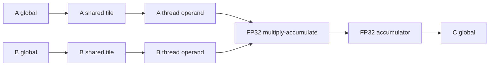

# Bounded BF16 GEMM dataflow

`src/kernel_mcts/dataflow.py` recognizes only the exact packaged CUDA root and
smoke-candidate sources under the fixed `bf16_gemm_4096_h100` workload and its
16×16 launch. It returns no graph if source, shape, dtype, layout, or launch
differs. The graph is diagnostic and does not affect MCTS validity, selection,
budget accounting, or reward.

The root follows this shared-tile path. It has two CTA barriers per K tile:
one after loading the tile and one before reusing shared storage. The candidate
instead connects A and B global loads directly to thread operands and has no
explicit shared staging or CTA barrier. Both assign one output C element to
each active thread.

| Source-level quantity, fixed 4096³ case | Tiled root | Direct-load candidate |
|---|---:|---:|
| A and B global element references × 2 bytes | 16 GiB | 256 GiB |
| C stores × 2 bytes | 32 MiB | 32 MiB |
| Multiply-accumulates | 68,719,476,736 | 68,719,476,736 |
| Explicit shared reuse per loaded A/B element | 16 threads | None |
| CTA barriers per block | 512 | 0 |

These are counts from the CUDA source and fixed shape, **not measured HBM or L2
traffic**. Hardware caches, broadcasts, compiler transformations, transaction
widths, and spills can change physical traffic. In the H100 validation trace,
the root's bounded SASS summary includes 32 shared loads and two shared stores,
while the candidate has no shared loads or stores; both have zero tensor-category
instructions. The summary supports the structural distinction but is not an
execution-count or traffic measurement. The candidate has no NCU profile in
that trace, so the 16× source-level difference is a hypothesis to investigate,
not a measured bottleneck attribution.

Each edge lists possible H100 resource links. For example, a tiled global-to-
shared assignment passes through the model's L2/L1, L1/register, and
register/shared paths. The graph does not assign bytes to those links; the
HBM-to-L2 contribution remains unknown because global loads can hit cache.

SQLite stores one versioned graph per recognized node in
`node_dataflow_graphs`. Existing traces are backfilled when opened by
`SQLiteTraceStore`. The trace browser is read-only: it uses a stored graph
when available, or derives the same bounded graph from the stored node source
and workload. Selecting a dataflow edge highlights its possible links in the
GPU resource view. Unrecognized kernels show an explicit unavailable message.

Next evidence should be a same-worker NCU profile for both kernels with DRAM,
L2, and shared-memory byte or sector counts. Compare those measurements with
the source-level demand before using the model in prompts or search priors.

## Generated CUDA nodes

At `node_created`, every valid CUDA node with nonempty source now receives a
cached graph. The two exact packaged sources retain the quantitative model above.
Other sources receive a `logical_and_static_sites` graph. For a GEMM workload, A
and B appear as separate logical operands of GEMM, with C as its logical output.
Those arrows come from the workload contract, not from compiler dependencies.
Available SASS instruction categories appear as a separate, disconnected row of
static site counts. They may include mutually exclusive or inactive branches.
They cannot establish which tensor feeds an instruction, how often a path runs,
or bytes transferred. A node without parsed SASS still gets the logical contract
when available; otherwise it reports unresolved paths.

SQLite schema 15 upgrades older dataflow graphs to version 2. Subsequent node
snapshots and profiles retain the same graph rather than extracting it again.
The browser can derive a missing or older graph read-only from node source and
compiler metadata. These graphs remain diagnostic: they do not change candidate validity,
MCTS selection, profiling policy, or budget accounting. A parent/child graph diff
is planned; it will need to preserve unknowns and evidence provenance.

The trace browser shows a dataflow diagram for each selected A/B node alongside
its source. Edge labels show source-level quantities on exact models and `logical`
on generated-node contracts; SASS site counts appear on their disconnected nodes.
An `unknown` label means there is no defensible numerical estimate. Each diagram
scrolls horizontally at narrow widths; selecting an edge shows its provenance and
possible hardware links. The cross-run comparison is for different search runs,
not for comparing two kernels in one run.
