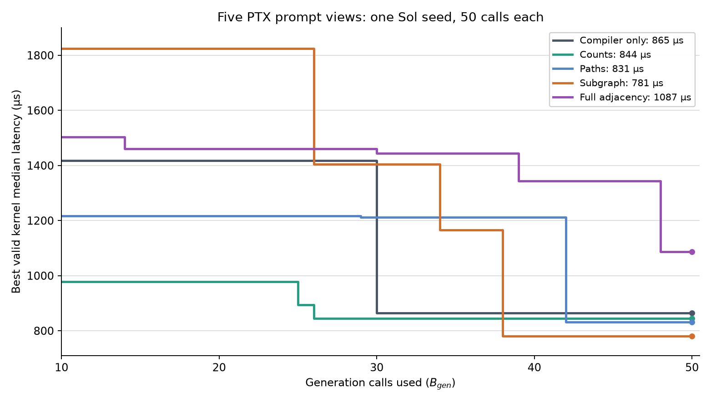

# Trace analysis: five PTX prompt views, Sol seed 0

## Scope and method

This is a read-only analysis of the five completed `B_gen=50` SQLite traces
described in [the pilot report](ptx-dataflow-view-seed0.md). It compares the
exact stored prompts, generation records, winning source edits, search
trajectories, and lightweight NCU profiles. No new model or GPU calls were
made. The five first-generation prompt objects are identical after removing
`parent_dataflow`; all use the same root source, compiler summary, strategy,
workload, and hardware fields. Later prompts differ in parent kernels and
selected strategies because each search follows its own tree.

The main question is which *observed information* supports useful edits. A
trace cannot prove that the model used a particular graph edge: it stores
source proposals, not the model's hidden reasoning, and candidate edits often
change several mechanisms together. Model sampling and MCTS trajectories are
stochastic even with the same controller seed. Claims below distinguish
measured outcomes, plausible mechanisms, and untested hypotheses.

## Search outcomes and when they appeared

| View | Valid / 50 | Best µs | Call finding final best | Input tokens | Multi-accumulator calls |
|---|---:|---:|---:|---:|---:|
| Compiler only | 40 | 865.1 | 30 | 108,283 | 9 |
| Counts | 41 | 844.1 | 26 | 129,041 | 6 |
| Paths | 42 | 831.4 | 42 | 169,640 | 9 |
| Subgraph | 40 | **780.9** | 38 | 220,395 | 10 |
| Full adjacency | 40 | 1,087.1 | 48 | 880,052 | 3 |

The curves cross. At call 30, compiler-only already had 865.1 µs while
subgraph remained at 1,404.0 µs; subgraph's 780.9 µs kernel arrived at call
38. Paths did not reach 831.4 µs until call 42, and full adjacency's best
arrived at call 48. A comparison stopped at an earlier `B_gen` would have
given a different apparent ranking. All arms had similar validity (40–42 of
50). The control had one infrastructure failure, not a model invalidity; all
other invalid proposals were predominantly compilation failures.

The `tensor_core_multi_accumulator` strategy was sampled 10 times in the
subgraph arm and three times in the full arm. Subgraph's winning path uses it
twice. This difference in opportunity is one concrete mediator of the final
gap; the trace does not establish whether the graph view caused that strategy
allocation. PUCT scores strategies before the dataflow view is inserted into
the generation request. The view can change a generated realization and its
reward, which can then change later tree selection indirectly.

## What each prompt actually exposed

Every graph-bearing prompt reported `status: partial`. The compiler-only
control already exposed `ptxas` registers, static shared memory, spill
diagnostics, and static SASS instruction-family counts. Graph views added
static PTX information, with these representative exposures:

| Parent prompt | Added PTX evidence | Practical limit |
|---|---|---|
| Root, counts | 2 global loads, 2 shared stores, 32 shared loads; 116 local definition/use edges | Static sites only; no tensor instruction in the scalar root |
| Root, paths | Eight selected local paths, mostly one site each | Little connected memory-to-compute information |
| Root, subgraph | 10 sites and three edges, all three arithmetic-to-arithmetic; 152 sites and 119 edges omitted | No selected memory-to-compute path |
| Root, full | 162 sites and 122 edges, including 101 arithmetic sites | Much more context, but the root still has no tensor path |
| Subgraph winner's parent, call 38 | 45 selected sites, 128 edges; 28 tensor sites and 93 tensor-to-tensor edges | 817 sites and 765 edges omitted; shared-store to WMMA-load alias remains unproven |
| Full winner's parent, call 48 | 608 sites and 412 edges; 365 arithmetic and 104 control sites | Full static adjacency is large and still lacks runtime traffic and alias edges |

The graph does not record dynamic transfer counts, bytes on an edge,
frequency of a branch, or a measured critical path. In particular, it cannot
yet join a shared-memory write to the later WMMA load of that location. The
root paths and subgraph therefore contain less actionable path information
than their names suggest. Across all 50 paths prompts, 255 of 400 selected
paths (64%) had only one site; 16 prompts contained at least one path with
three or more sites. Bounded subgraphs averaged 22 selected sites and 28
edges per prompt, while full views averaged 252 sites and 210 edges. Full
adjacency supplies many more sites but much of
its prompt is arithmetic/control detail. It used 8.13 times the control's
input tokens and 4.0 times the subgraph arm's, without an observed validity
gain in this seed.

## What the winning edits did

| View | Winning ancestry | Measured step and visible source change |
|---|---|---|
| Compiler only | Calls 24 → 30 | 2,927.8 → 865.1 µs; introduced asynchronous shared staging and reorganized WMMA accumulator reuse |
| Counts | Calls 17 → 26 | 1,292.1 → 844.1 µs; reorganized output fragments, WMMA operations, and output staging |
| Paths | Calls 10 → 29 → 42 | 1,216.6 → 1,212.4 → 831.4 µs; final edit added `cp.async` staging and changed multi-accumulator scheduling |
| Subgraph | Calls 34 → 38 | 1,165.2 → **780.9 µs**; changed `BLOCK_N` 64 → 128, from four to eight accumulator fragments per warp, and changed warp/output staging |
| Full | Calls 39 → 48 | 1,343.0 → 1,087.1 µs; added `cp.async` with double-buffered input staging and changed output handling |

For the decisive subgraph step, the parent prompt exposed 80 registers per
thread, 32 KiB static shared memory, zero reported spill bytes, and 32 static
SASS tensor sites in its **compiler summary**. The selected PTX subgraph
highlighted tensor dependencies. The selected strategy text also explicitly
asked for multiple independent accumulators and reuse of staged operands.
The resulting source widened the output tile and doubled fragments, but also
changed warp ownership, synchronization, and output stores. The trace cannot
assign the 33% latency reduction to one of those edits or to one prompt field.

Lightweight NCU profiles provide a useful *post hoc* check of that step:

| Subgraph node | Median µs | Registers/thread | Achieved occupancy | Tensor-pipe utilization | Executed instructions |
|---|---:|---:|---:|---:|---:|
| Call 34 parent | 1,165.2 | 80 | 34.55% | 20.71% | 286.3 million |
| Call 38 child | **780.9** | 128 | 23.39% | 29.98% | 186.9 million |

The faster kernel used more registers and had lower occupancy, while its
tensor pipe was busier and fewer instructions executed. That supports a
hypothesis that more useful tensor work per block outweighed the occupancy
cost on this workload. These NCU values were collected on expansion and were
**not** included in the generation prompts. They are whole-kernel summaries,
not time attribution to PTX edges or AST nodes.

## What appears useful, and what remains unknown

1. **Semantic transformation guidance and source context were sufficient to
   find the main performance mechanism.** Every arm produced WMMA-based
   kernels, and the compiler-only arm reached 865.1 µs. The selected strategy
   text often named the same accumulator, tiling, or staging change later seen
   in the source. This is direct evidence that a graph is not required for
   these transformations to occur.
2. **Compact graph context is worth testing again, not yet validated as a
   cause.** Counts, paths, and subgraph ended 2.4%, 3.9%, and 9.7% below the
   matched control in this seed. Validity was similar and the subgraph winner
   arose from a known strategy. The selected subgraph's concentration of tensor
   sites may help focus a proposal; the trace cannot separate that from
   stochastic output and search allocation.
3. **Full adjacency had poor observed return on context in this seed.** It
   ended 25.7% above the control, with 8.13 times the input tokens. Its best
   still improved late, so the arm was productive. This is a cost/performance
   observation, not proof that more graph information confuses the model.
4. **The current graph omits the most valuable movement relationship.** It
   cannot prove shared-store to tensor-load aliasing or attach measured
   traffic to an edge. The root paths are mostly isolated sites; the root
   subgraph's three edges are arithmetic. We should improve these links and
   selection policy before treating this as a complete data-movement prompt.

Even with the same root and selected multi-accumulator strategy, individual
root proposals across arms ranged from about 1,165 to 4,807 µs. There is also
large variation within each arm. This is why a single best node per arm is a
weak estimator of prompt value. The first-generation non-graph prompt fields
match exactly across arms, but the generated results differ; one sample each
cannot separate a view effect from model sampling.

## Next discriminating experiment

Replay a small set of **identical parent kernel + strategy** situations
under each view, with several independent model samples per cell. Use the
scalar root and a verified WMMA parent such as subgraph call 34. Keep source,
strategy wording, compiler summary, model settings, workload, and evaluation
worker fixed. Compare correctness, immediate child latency distributions,
specific code changes, and tokens. This removes MCTS strategy-allocation and
parent-selection differences from the primary question. Separately repeat
whole-tree arms over more seeds to measure search-level benefit. No new run
was launched as part of this analysis.
