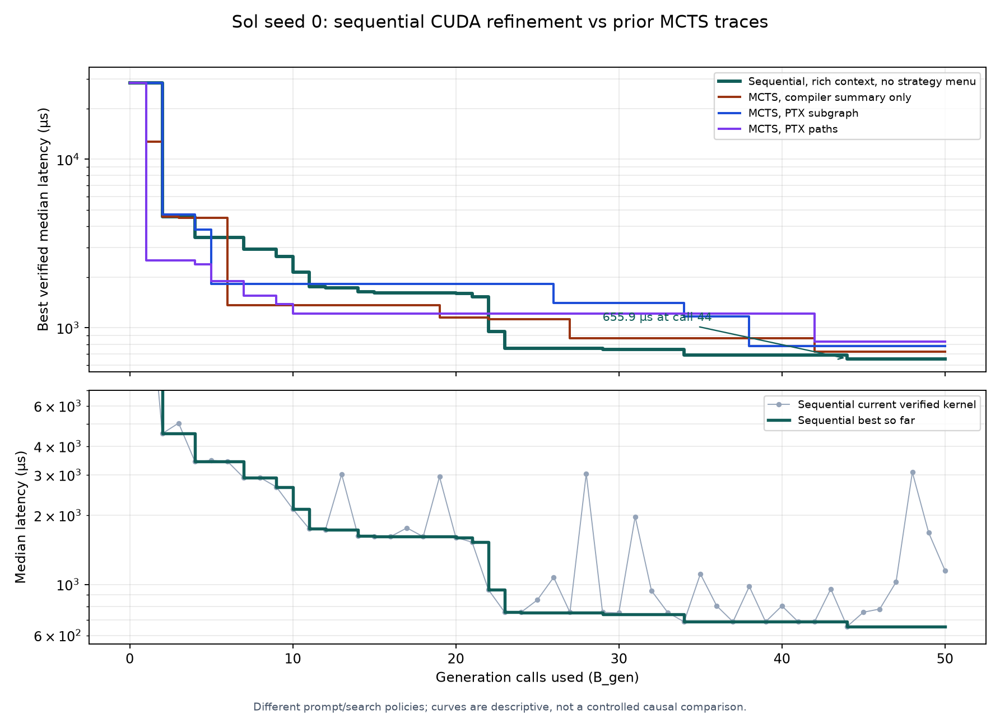

# Sequential CUDA refinement: Sol seed 0, `B_gen=50`

## Run and verification

The standalone sequential loop used `gpt-5.6-sol` at medium reasoning on one
Nebius H100 SXM worker. The worker image was pinned to
`sha256:f90da644bcabc3a07756ecea933f4e1bc2d7faa5785e1c5d39c851eecedb0429`.
The root, 4096³ BF16 GEMM workload, CUDA 12.8.2, NCU 2025.1.1, and tier-0
measurement contract match the prior Sol CUDA prompt studies. The prompt
included source, measured benchmark, the **lightweight_v1** NCU profile,
bounded ptxas/SASS summary, and the PTX `paths` view. It had no strategy menu
and no full H100 resource graph. The model had no browsing tool. The local
conversation replayed at most two prior visible user/assistant turns. One
repair was allowed per logical proposal; every call counted toward `B_gen`.

The run ID is `14d8d89d-bce7-474d-b49d-5622bd882b11`. The local artifacts
are [`sequential-sol-bgen50-seed0.sqlite`](../../sequential-sol-bgen50-seed0.sqlite)
and the [best source](../../sequential-sol-bgen50-seed0-best.cu). The preliminary
`B_gen=3` smoke trace is
[`sequential-sol-smoke-bgen3-seed0.sqlite`](../../sequential-sol-smoke-bgen3-seed0.sqlite).
The smoke finished with one invalid call, a valid repair, and a second valid
improvement to 3,583.1 µs; its SQLite integrity and prompt hashes passed.

The full trace passed `PRAGMA integrity_check`; it contains exactly 50 ordered
generations with matching prompt SHA-256 hashes. All 50 prompts exposed a
`partial` PTX graph, available compiler summary, and `lightweight_v1` NCU
profile. It has 47 valid and three invalid proposals, 47 accepted steps,
seven reused valid states, 41 distinct nodes, and 41 profiles including the
root. All distinct nodes have dataflow records. The exported best source
matches the best node's stored source. Nebius listed no instance or disk after
the provider cleanup.

| Measure | Sequential result |
| --- | ---: |
| Root median, 30 samples | 28,244.4 µs |
| Best median, call 44, 30 samples | **655.856 µs** |
| Best mean / standard deviation | 652.478 / 4.999 µs |
| Best sample range | 645.120–657.280 µs |
| Root-relative speedup | 43.06× |
| Input / output tokens | 1,368,533 / 197,229 |
| Sum of LLM request latencies | 2,054.5 s |
| Worker occupancy wall time | 2,459.7 s (41.0 min) |

Worker occupancy is a cost proxy, not a provider billing record. The 30 samples
describe within-run timing variance; the best kernel has not yet been
remeasured on a fresh worker.

## Descriptive comparison with existing MCTS traces

These are single-seed traces with the same model, root, image, generation-call
budget, and tier-0 measurement contract. Prompt exposure and search policy
both differ, so the table cannot attribute the gain to the absence of a
strategy menu, linear acceptance, or any one context component.

| Sol seed 0 arm | Best median µs | Valid / 50 | Profiles | Input tokens |
| --- | ---: | ---: | ---: | ---: |
| Sequential, lightweight NCU + compiler + PTX paths | **655.9** | 47 | 41 | 1,368,533 |
| MCTS, compiler summary only | 724.4 | 41 | 17 | 106,838 |
| MCTS, PTX subgraph + compiler | 780.9 | 40 | 14 | 220,395 |
| MCTS, PTX paths + compiler | 831.4 | 42 | 17 | 169,640 |

The sequential best is 9.46% lower in latency than the 724.4 µs compiler-only
MCTS seed 0 result. Its input-token count is 12.8× as large, largely because
the two-turn local conversation replays earlier full prompts and sources.
Its 41 profiles also reflect profiling every newly accepted node rather than
MCTS's lazy profiling on expansion. The plot's lower panel shows that the
current kernel was often slower than the saved best; valid local slowdowns
were retained and sometimes led to later improvements.

## Edits along the 50-call sequence

The descriptions below combine the model's recorded hypothesis with source
comparison. Calls 2, 7, 10, 11, 22, 23, 30, 33, 34, and 44 were inspected
with source diffs; the remaining descriptions are concise labels for their
recorded hypotheses and source signatures. A row with `same` reused a
previously verified source. Latency is the resulting candidate's median, not
the best-so-far. This sequence is observational: many proposals change more
than one mechanism, and a parent-to-child latency difference does not isolate
one edit's effect.

| Call | Result µs | Main change | Closest catalog theme |
| ---: | ---: | --- | --- |
| 1 | invalid | Introduce split-K BF16 WMMA; fragment type failed compilation | gap: tensor-core bootstrap |
| 2 | 4,546.6 | Repair WMMA type, retaining split-K partial reduction | gap: tensor-core bootstrap |
| 3 | 5,047.3 | 32×32 macro-tile and staged vector loads | output tiling, vector access |
| 4 | 3,434.9 | Register reuse across 32×32 outputs; remove panel barriers | multi-accumulator, synchronization |
| 5 | 3,471.5 | Full-K warp-owned 128×32 strips, removing split-K | output tiling |
| 6 | 3,435.6 | 64×32 with two-way split-K | gap: split-K |
| 7 | 2,915.1 | 64×64 and four accumulators per warp | multi-accumulator |
| 8 | 2,922.0 | 128×64 full-K warp mapping | output tiling |
| 9 | 2,659.0 | 128×128 and eight accumulators per warp | multi-accumulator |
| 10 | 2,134.5 | Shared staging of A/B panels | data-movement pipeline |
| 11 | 1,752.6 | Two-stage `cp.async.cg` pipeline | data-movement pipeline |
| 12 | 1,728.7 | 128×64, fewer registers, two-block launch bound | register pressure |
| 13 | 3,019.0 | K tile 64 and vectorized epilogue | pipeline, vector access |
| 14 | 1,631.9 | Restore K tile 32; three-block launch bound | register pressure |
| 15 | 1,616.4 | Four-block launch bound | register pressure |
| 16 | invalid | 128×128 plus vector epilogue; incomplete output coverage | multi-accumulator, vector access |
| 17 | 1,763.8 | Repair 128×128 epilogue coverage | vector access |
| 18 | 1,615.1 | Restore 128×64; BF16x2 epilogue stores | vector access |
| 19 | 2,945.5 | K tile 64 | data-movement pipeline |
| 20 | 1,603.9 | Restore K tile 32; row-major shared epilogue | epilogue, synchronization |
| 21 | 1,528.6 | 128×128, eight accumulators | multi-accumulator |
| 22 | 948.7 | K tile 48 with zero-filled async tail | data-movement pipeline |
| 23 | 756.1 | 32×64 warp tile; reuse B across two A rows | multi-accumulator |
| 24 | 756.1 same | Rewrite intended to alternate B fragments; verified source reused | same state |
| 25 | 855.7 | `cp.async.ca` cache policy | data-movement pipeline |
| 26 | 1,074.1 | Three-stage K tile 32 pipeline | data-movement pipeline |
| 27 | 756.1 same | Restore K tile 48 and `.cg` | restore |
| 28 | 3,037.7 | 128×64, K tile 64 | output tiling, pipeline |
| 29 | 756.1 same | Restore 128×128, K tile 48 | restore |
| 30 | 751.5 | Compile-time 4096³ specialization | specialize workload shape |
| 31 | 1,974.9 | Three-block launch bound | register pressure |
| 32 | 939.4 | 128×64, four accumulators | output tiling |
| 33 | 754.5 | Return to 128×128; direct register-to-BF16 epilogue | epilogue, multi-accumulator |
| 34 | 687.5 | K=4096 tail: 85 full K=48 stages, then K=16 | specialize workload shape |
| 35 | 1,111.7 | K=32 three-stage pipeline | data-movement pipeline |
| 36 | 806.5 | Restore K=48 with `.ca` | cache policy |
| 37 | 687.5 same | Restore `.cg` | restore |
| 38 | 980.3 | 128×64 to seek higher occupancy | output tiling, register pressure |
| 39 | 687.5 same | Restore 128×128 | restore |
| 40 | 806.5 same | Reuse earlier `.ca` variant | cache policy |
| 41 | 687.5 same | Restore `.cg` | restore |
| 42 | invalid | 64×128, three-block residency; async-copy bounds failed | output tiling, register pressure |
| 43 | 955.9 | Repair async-copy bounds | data-movement pipeline |
| 44 | **655.9** | Restore 128×128 and remap useful CTAs to grid prefix | gap: CTA scheduling |
| 45 | 757.0 | `.ca` with prefix CTA mapping | cache policy |
| 46 | 781.2 | `.cg` and per-thread copy remapping | data-movement pipeline |
| 47 | 1,023.8 | K=32 three-stage pipeline | data-movement pipeline |
| 48 | 3,084.5 | 64×128, K=64 | output tiling, pipeline |
| 49 | 1,681.9 | Restore 128×128 K=48; three-block bound | register pressure |
| 50 | 1,151.7 | 128×256 K=32, more accumulator chains | multi-accumulator |

The most informative isolated source comparison is call 34 versus call 44.
Those two valid sources differ only in the CTA-to-output mapping: call 34
activates CTAs at every eighth grid coordinate, whereas call 44 maps the
first 1,024 fixed-grid CTAs contiguously to 128×128 output tiles. Their
medians were 687.504 and 655.856 µs respectively. This supports a targeted
same-worker A/B replay of the mapping change; it does not rule out temporal
measurement drift. The corresponding lightweight profiles report 128
registers/thread and 49,152 static shared-memory bytes in both cases, with
tensor-pipe utilization 32.75% versus 33.23% and achieved occupancy 22.49%
versus 23.83%.

## Strategy implications and next tests

Most productive middle-run edits fit the existing output-tiling,
multi-accumulator, pipeline, or shape-specialization strategies. The early
split-K tensor-core bridge from the scalar root conflicts with the current
output-tiling and pipeline prompts, which explicitly prohibit cross-warp
partial reductions. The final CTA remapping is only weakly covered by the
catalog's broad output-tiling language. Direct register epilogue writes and
launch-bound/occupancy tuning are also more specific than their nearest
existing strategy descriptions.

Before changing priors or the strategy catalog, remeasure the 655.9 µs kernel
on a fresh matched worker, replay call-34 versus call-44 sources in alternating
order, and repeat sequential seeds. Then run an explicit-menu sequential arm
with the same context and history policy to isolate the effect of offering
strategies. A separate experimental MCTS variant could add a bounded freeform
proposal action beside semantic strategies, but `spec.md` currently defines
PUCT over semantic strategies; that variant requires an explicit design/spec
decision rather than a silent change to Milestone A MCTS semantics.
