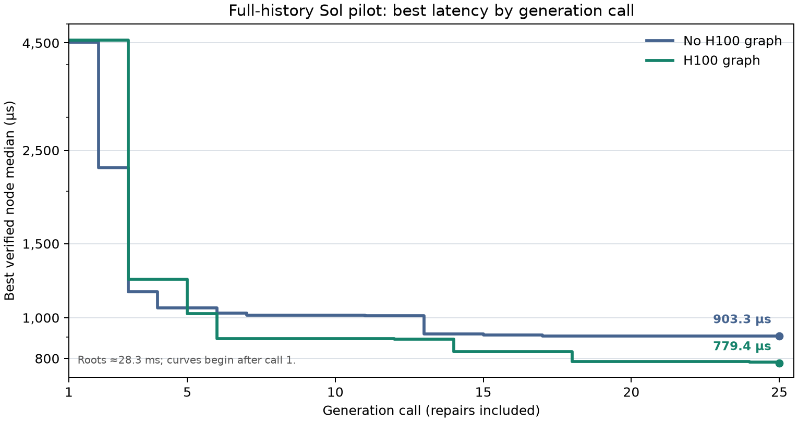

# Trace analysis: full-history Sol pilot with and without the H100 graph

This is a read-only comparison of the two completed `B_gen=25` sequential CUDA traces in the [paired-run report](sequential-sol-full-history-h100-graph-bgen25-seed0.md). It inspects stored prompts, hypotheses, verified sources, benchmark samples, compiler resources, and `diagnostic_v2` NCU profiles. No new model or GPU evaluations were made. The question is **what changed in the sampled refinement paths**, not whether this one pair proves the graph caused a better result.

## Comparable setup and important differences

Both runs used the same root source hash (`e0896de153e891a17cbd8c58e8c82b69dbf508ff175ee393b6e93e1139d540a8`), workload, Sol model, generation budget, seed, pinned H100 worker image, full-history policy, compiler summary, PTX `paths` view, diagnostic NCU metric set, and one repair per proposal. Each used a newly provisioned H100 SXM worker. The root medians were 28,256.784 µs without the graph and 28,458.305 µs with it. The run configs share Git commit `4367a56d531ec9c3ced854e97e9dc8bb60aa6c0a` and report a dirty tree; they do not fingerprint the local diff.

Both SQLite files passed `PRAGMA integrity_check`. All 50 prompts had the expected full-history message count (`2 × B_gen − 1`), an available compiler summary, a `partial` PTX dataflow view, and a full `diagnostic_v2` parent profile. The graph appeared in the latest message of all 22 normal graph-arm proposals. Three repair messages omitted it from their latest message because of a request-copy bug, although prior graph-bearing turns remained in full history. The bug was fixed after these runs. There was no fixed strategy menu or best-source anchor in either arm.

Only the **root** source hash occurs in both node sets. The same controller seed does not pair later parent states or model samples, and different worker measurements appear in the context. Consequently, the two paths cannot isolate a prompt effect at a fixed parent.

## Where the trajectories diverged

The plot uses the saved node's median when a valid new node is created. Invalid/repair calls still occupy their `B_gen` positions; valid slower calls leave the best-so-far line flat. The naive roots around 28.3 ms are omitted from the plotted range.

| `B_gen` reached | No graph: best µs | H100 graph: best µs | Milestone |
| ---: | ---: | ---: | --- |
| 1 | 4,520.8 | 4,565.5 | Both replace scalar work with BF16 WMMA. |
| 3 | **1,153.5** | 1,233.0 | No-graph path begins shared-panel refinement; graph call 3 repairs a failed 128×128 proposal. |
| 6 | 1,025.7 | **890.5** | Graph path reaches a 128×128, K=64 macro-tile; no-graph path double-buffers 64×64 panels. |
| 10 | 1,013.2 | **890.5** | Graph arm spends calls 7 and 10 on invalid candidates, with repairs at 8 and 11. |
| 14 | 914.4 | **830.0** | Graph arm returns to K=64 and changes async-copy cache policy and final barrier. |
| 17 | 903.3 | **830.0** | No-graph arm reaches its final best. |
| 18 | 903.3 | **785.9** | Graph arm compacts productive CTAs and specializes fixed-shape indexing. |
| 25 | 903.3 | **779.4** | Graph arm hoists copy-address calculations; this final change is small. |

The graph arm was ahead by call 6, before its late CTA mapping change. Its best ended at 779.360 µs versus 903.280 µs without the graph: a 123.920 µs (13.7%) cross-run difference. The graph arm had 22 valid and three invalid calls, with 22 distinct profiled nodes including root. The no-graph arm had 24 valid and one invalid call, with 25 distinct profiled nodes.

## What the winning implementations actually do

| Source feature | No-graph best, call 17 | Graph best, call 25 |
| --- | --- | --- |
| Output region per productive CTA | 64×96 | 128×128 |
| FP32 WMMA accumulators per warp | 3 | 8 |
| K panel / shared leading dimension | 64 / 72 BF16 elements | 64 / 72 BF16 elements |
| Global-to-shared copy | Double-buffered `cp.async.cg` with `L2::128B` hint | `cp.async.ca`, one shared panel pair per K stage |
| Productive CTAs within the fixed 256×256 launch | 64×43 = 2,752, sparsely mapped | 32×32 = 1,024, placed at the front of the launch |
| Fixed workload handling | General tiled path with masked N tail | Specialized compact mapping for exactly 4096³; other shapes retain a scalar path |

These are different kernel designs, not the same source with one prompt-induced patch. The graph arm's early 128×128 tile increased reuse and accumulator count. Call 12 replaced register-mediated panel transfers with `cp.async` (889.6 µs). Comparing the saved call-12 and call-14 sources, call 14 changed `cp.async.cg` to `.ca` and removed the final loop barrier; its median was 830.0 µs. The two edits are coupled, and call 13 was an intervening slower candidate, so the trace does not isolate a cache-policy effect.

Call 18 proposed to put the 1,024 productive macro-tiles in the first 1,024 positions of the fixed 65,536-block launch instead of accepting one block per 8×8 region. Its direct parent at call 17 had an 88-element shared stride; call 18 also restored the 72-element stride and introduced exact-4096 specialization. The useful source comparison is call 14 (830.0 µs, stride 72, sparse CTAs) versus call 18 (785.9 µs, stride 72, compact CTAs plus specialization). The 44.1 µs difference is promising, but still combines mapping and fixed-shape constants and was measured at different times. A same-worker alternating A/B replay is the appropriate test of this mechanism.

Call 25 moved lane-to-panel address decomposition outside the K loop and added `__restrict__` and `__launch_bounds__(256, 2)`. It improved the saved median from 783.7 to 779.4 µs. This 4.3 µs difference is close to the individual runs' few-microsecond sample spread, so it should not be treated as a validated optimization without a replay.

## NCU and compiler evidence at the two best nodes

| Metric | No graph, 903.3 µs | Graph, 779.4 µs |
| --- | ---: | ---: |
| Registers per thread | 64 | 128 |
| Static shared memory per block | 46,080 B | 36,864 B |
| Achieved occupancy | 48.49% | 24.11% |
| DRAM bytes read | 649.5 MB | 297.2 MB |
| DRAM bytes written | 32.3 MB | 32.8 MB |
| Executed instructions | 397.2 million | 141.4 million |
| Tensor-pipe utilization | 23.62% | 27.63% |
| SM throughput | 56.45% | 45.52% |
| L2 sector hit rate | 85.97% | 73.82% |

The graph winner is faster with **more registers and lower achieved occupancy**. It also has roughly 2.2× fewer measured DRAM read bytes and 2.8× fewer executed instructions, consistent with its larger output tile and fewer productive CTAs. Similar DRAM write totals are expected because both write the full output. These are whole-kernel NCU observations from different implementations and workers; they do not assign time or bytes to individual PTX or hardware-graph edges. Lower occupancy did not prevent a better measured latency in this pair.

The resource graph does help **interpret** this occupancy difference. Both kernels use 256-thread CTAs. Ignoring allocation granularity, 65,536 registers per SM divided by `256 × registers_per_thread` allows at most four no-graph CTAs (64 registers/thread) or two graph-arm CTAs (128 registers/thread). Those counts correspond to 32 versus 16 resident warps out of the architectural 64, or roughly 50% versus 25%. The measured 48.49% and 24.11% are close. Their shared-memory footprints would permit more CTAs than these register bounds, so registers are the tighter simple limit here. This calculation explains an observed resource tradeoff; it is not a measured live overlay on the graph or proof of why the graph arm was chosen.

The best-node 30-sample benchmarks were 903.280 µs median with 3.672 µs standard deviation and 779.360 µs median with 2.641 µs standard deviation. The 123.920 µs gap is much larger than the within-run sample spread. It still does not measure between-worker drift or stochastic search variance. Both roots' recorded SM and memory clocks were 1,980 and 2,619 MHz, respectively, during their root benchmarks.

## Did the model use the H100 graph?

The trace shows **exposure, not reliance**. The graph-bearing prompt supplied per-SM register capacity, shared-memory and thread limits, a published HBM peak, and pathways with unknown sustainable rates and latencies. The model's call-6 hypothesis reasoned that a register-limited CTA could spend more shared memory without reducing occupancy. Call 14 discussed the L1/shared pool while choosing `.ca`; call 18 reasoned about productive-block scheduling. But compiler `ptxas` resources, NCU occupancy/traffic, current source, and the model's existing knowledge were also in the prompt. The graph has no CTA launch-order model and no measured per-link traffic. Neither the hypotheses nor the source changes identify a graph-only fact as the cause of an improvement.

One invalid proposal reveals a practical gap in the graph's resource guidance. At graph call 7 the model proposed a K=128 panel using 69,632 bytes of static shared memory, reasoning that it fit the H100 architectural per-block capacity. `nvlink` rejected it: the entry used `0x11000` bytes versus the build's `0xc000` (48 KiB) default maximum. The graph did warn that large shared allocations may need opt-in, but it did not give the effective default linker/launch limit for this harness. Call 8 spent a repair to reduce the allocation. This is an observed compile constraint, not evidence that the H100 architectural maximum is wrong. The other graph-arm invalid calls were one unsupported WMMA store type (call 2) and one correctness failure after a warp remap (call 10).

The graph arm recorded 3,115,168 input tokens, including 2,867,983 cached tokens (92.1%), and 60,396 output tokens. The no-graph arm recorded 3,297,437 input and 87,964 output tokens; cache-hit accounting was not yet enabled. The graph-bearing arm used fewer total tokens because its generated sources and subsequent prompts were much shorter (mean candidate source 4,602 versus 9,170 characters), despite the added graph field. This is a path effect, not evidence that adding a graph reduces prompt cost. The graph arm's three repair latest messages lacked the graph because of the now-fixed request-copy bug.

## Interpretation and next discriminating tests

The paired pilot is consistent with a useful graph-conditioned search path, but **does not establish that the graph improved generation**. The arms share only the root node, differ in repair outcomes and source lengths, and were run on different workers. The decisive source differences are larger tile/accumulator ownership, async-copy policy, and compact CTA mapping. The graph's unique contribution to those choices remains unknown.

1. On one worker, alternately remeasure the saved 903.280 and 779.360 µs kernels, graph call 14 versus call 18, and the graph call-24 versus call-25 sources. This will check cross-run timing and separate a likely material mapping change from a small late change. Do not infer that `__launch_bounds__`, `__restrict__`, and address hoisting individually helped from call 25.
2. For prompt causality, sample several proposals from the **same verified parent source and profile** with and without the H100 graph, holding model, current source, full-history policy, and generation instructions fixed. Compare the proposed edits, validity, immediate-child latency distributions, and token/cache cost. A full-history replay needs identical preceding messages up to the tested turn; otherwise earlier divergence changes the context.
3. Repeat whole sequential arms over matched seeds after the repair-context fix, recording cached-token counts in both arms. This tests search-level benefit rather than one-step proposal influence. Include the effective shared-memory opt-in/default limit in future context only when it is verified for the actual build and launch path.

Local traces: [no graph](../../sequential-sol-full-history-diagnostic-bgen25-nograph-seed0.sqlite) and [H100 graph](../../sequential-sol-full-history-diagnostic-bgen25-h100graph-seed0.sqlite). Both remain local artifacts outside Git; this report and plot retain the auditable summary.
