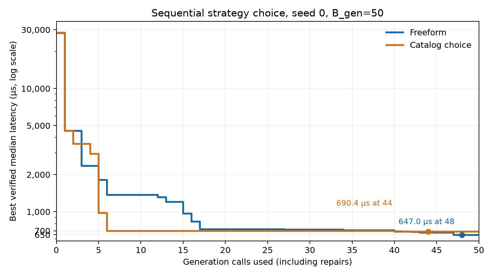

# Sequential strategy choice: two-turn seed-0 pilot

## Setup and artifacts

This is the first matched freeform/catalog pair from the
[strategy-choice plan](sequential-strategy-menu-plan.md). A three-call catalog
smoke passed first: one invalid generation, a valid repair that retained
`tensor_core_output_tiling`, and a later valid `tensor_core_multi_accumulator`
generation. Its trace is
[`sequential-sol-choice-smoke-bgen3-seed0.sqlite`](../../sequential-sol-choice-smoke-bgen3-seed0.sqlite).

Both full arms used `gpt-5.6-sol` at medium reasoning, seed 0, `B_gen=50`,
one repair, two prior visible user/assistant turns, the same 4096³ BF16 GEMM
root and tier-0 verification/timing contract, and the pinned H100 worker image
`sha256:f90da644bcabc3a07756ecea933f4e1bc2d7faa5785e1c5d39c851eecedb0429`.
They collected `lightweight_v1` NCU metrics with full prompt visibility and
included the bounded full ptxas/SASS compiler summary and PTX dataflow `paths`
view with limits. Neither arm supplied best-so-far source or the H100 resource
graph. The only planned prompt factor was the ordered eight-strategy menu from
`configs/strategies.yaml`. Its file SHA-256 was
`cc7820e2558eb13b9f9dfa344ee2c2f09b101b56a4648e473c3e0273593dafdc`;
the exact rendered menu and prompt schema version 2 are in the catalog run
configuration. Both arms shared the same instructions hash.

| Arm | Run ID | Trace | Best source |
| --- | --- | --- | --- |
| Freeform | `d1b7f87e-d885-419c-91d1-7f59ec00baed` | [`sequential-sol-choice-freeform-bgen50-seed0.sqlite`](../../sequential-sol-choice-freeform-bgen50-seed0.sqlite) | [`sequential-sol-choice-freeform-bgen50-seed0-best.cu`](../../sequential-sol-choice-freeform-bgen50-seed0-best.cu) |
| Catalog | `f95d9ad6-ac5d-4ccb-9e3a-b89e8ed81056` | [`sequential-sol-choice-catalog-bgen50-seed0.sqlite`](../../sequential-sol-choice-catalog-bgen50-seed0.sqlite) | [`sequential-sol-choice-catalog-bgen50-seed0-best.cu`](../../sequential-sol-choice-catalog-bgen50-seed0-best.cu) |

## Results

| Measure | Freeform | Catalog |
| --- | ---: | ---: |
| Root median, 30 samples (µs) | 28,244.384 | 28,455.248 |
| Best median, 30 samples (µs) | **647.008**, call 48 | **690.416**, call 44 |
| Best sample standard deviation (µs) | 3.952 | 1.748 |
| Valid / invalid generations | 47 / 3 | 43 / 7 |
| Accepted steps / distinct nodes | 47 / 43 | 43 / 33 |
| Profiles, including root | 43 | 33 |
| Input / output tokens | 1,289,290 / 179,433 | 1,570,914 / 194,929 |
| Cached input / cache-write input tokens | 13,181 / 1,275,959 | 14,949 / 1,555,815 |
| Sum of model request latency (s) | 1,834.8 | 2,007.5 |
| Worker occupancy (s) | 2,265.4 | 2,364.0 |

The catalog arm's final best was 43.408 µs (6.71%) slower than the freeform
arm's best. It reached a competitive kernel earlier, however:

| `B_gen` cutoff | Freeform best (µs) | Catalog best (µs) |
| ---: | ---: | ---: |
| 6 | 1,372.832 | **697.616** |
| 20 | 721.824 | **697.616** |
| 40 | **687.568** | 694.640 |
| 50 | **647.008** | 690.416 |

The catalog model declared a valid catalog ID on all 50 calls. Its choices
were `pipeline_tensor_core_data_movement` (12), `reduce_synchronization` (12),
`reduce_register_pressure` (10), `tensor_core_multi_accumulator` (8),
`specialize_workload_shape` (3), `vectorized_memory_access` (3), and
`tensor_core_output_tiling` (2). The freeform model returned its own descriptive
IDs on all 50 calls instead of the requested reserved ID `freeform`; each is
logged as `out_of_catalog`. These labels did not determine validity or
acceptance. They are a prompt-adherence deviation and show that the freeform
arm used unrestricted, self-named actions rather than a catalog.

Both SQLite files passed `PRAGMA integrity_check`. All 100 stored prompt hashes
match the exact recorded prompt text. Every prompt exposed `lightweight_v1`
and the `paths` dataflow view; the menu was present in all catalog prompts and
absent from all freeform prompts; the H100 graph was absent throughout. The
root source hash matched across arms, and each exported best source matched
its best node. Nebius listed no instance or disk after cleanup.

This pair compares two sampled search trajectories on separate H100 workers.
The 30 timing samples estimate within-kernel measurement spread, not variation
across model samples or search runs. The root medians differed by about 0.75%.
Repeat matched seeds before concluding that either arm has better expected
best latency, and inspect source transitions before attributing the difference
to catalog coverage or strategy-choice quality. Worker occupancy is a cost
proxy, not a provider bill.
