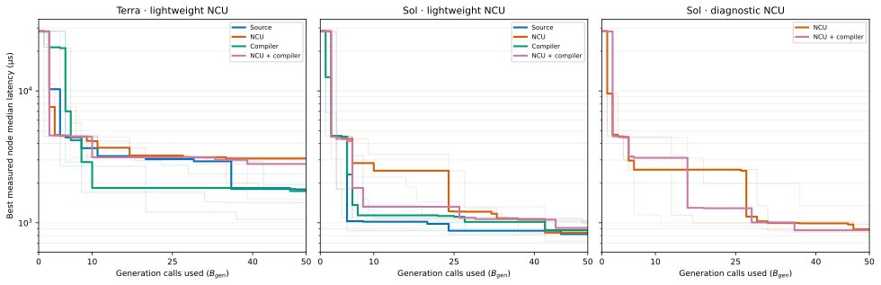

# Terra and Sol CUDA prompt-context study (`B_gen=50`)

## Scope

This report covers the October 2026 CUDA C++ BF16 GEMM prompt-context study:
three seeds for each of four prompt arms with Terra and Sol using
`lightweight_v1` NCU metrics, three seeds for each of two Sol arms using
`diagnostic_v2`, and one additional, unpaired Sol diagnostic combined run at
seed 3. The earlier `B_gen=10` pilot and older Sol-versus-Terra searches have
different designs and are not pooled here; see
[the pilot](compiler-prompt-ablation.md) and
[the earlier model comparison](nebius-sol-vs-terra-bgen50.md).

All runs used `B_gen=50`, medium reasoning effort, uniform strategy priors,
`c_puct=12`, `K_max=4`, `max_depth=10`, and at most one repair. The prompt arms
were:

- **Source:** source, workload, strategy, and hardware; parent NCU profile hidden.
- **NCU:** source plus the selected parent NCU profile.
- **Compiler:** source plus bounded parent `ptxas` resource and static SASS site
  summaries; parent NCU profile hidden.
- **NCU + compiler:** both parent summaries.

Profiling still occurred when nodes were expanded and for an unprofiled final
best in every arm. The prompt flags changed what the generator saw, not the
profiling schedule. The compiler prompt contained neither raw PTX nor raw SASS.

## Results

Each seed column is the run's **best kernel median latency in microseconds**;
lower is better. The median, valid-node count, tokens, NCU calls, and wall time
aggregate **seeds 0–2 only**. Token counts are thousands of input/output tokens,
rounded to one decimal. Wall time is the sum of recorded search start-to-end
minutes, not a cloud billing estimate.

| Model | NCU set | Prompt | Seed 0 | Seed 1 | Seed 2 | Seed 3 | Median 0–2 | Valid / 150 | Tokens in / out (k) | NCU calls | Wall min |
|---|---|---|---:|---:|---:|---:|---:|---:|---:|---:|---:|
| Terra | lightweight | Source | 1,792.9 | 1,936.2 | 1,062.0 | — | 1,792.9 | 96 | 299.2 / 380.2 | 31 | 103.2 |
| Terra | lightweight | NCU | 3,073.6 | 1,803.7 | 3,170.4 | — | 3,073.6 | 94 | 413.5 / 400.9 | 37 | 108.7 |
| Terra | lightweight | Compiler | 1,417.7 | 1,740.2 | 2,354.8 | — | 1,740.2 | 87 | 329.5 / 393.2 | 29 | 125.2 |
| Terra | lightweight | NCU + compiler | 3,005.2 | 1,500.9 | 2,795.4 | — | 2,795.4 | 85 | 441.9 / 431.4 | 37 | 116.4 |
| Sol | lightweight | Source | 821.3 | 1,042.3 | 815.8 | — | 821.3 | 118 | 325.5 / 578.1 | 41 | 161.4 |
| Sol | lightweight | NCU | 842.7 | 842.0 | 1,000.8 | — | 842.7 | 113 | 405.2 / 525.5 | 42 | 155.1 |
| Sol | lightweight | Compiler | **724.4** | 1,015.7 | 879.5 | — | 879.5 | 120 | 347.0 / 574.5 | 46 | 170.3 |
| Sol | lightweight | NCU + compiler | 989.1 | 914.4 | 847.9 | — | 914.4 | 117 | 450.4 / 563.7 | 45 | 176.7 |
| Sol | diagnostic | NCU | 893.7 | 971.3 | 876.4 | — | 893.7 | 113 | 537.9 / 557.3 | 43 | 162.5 |
| Sol | diagnostic | NCU + compiler | 849.6 | 877.7 | 1,348.3 | 959.8 | 877.7 | 110 | 578.6 / 546.6 | 46 | 159.8 |

The extra diagnostic combined seed 3 produced 39 valid nodes in 50 calls,
187,284 input and 190,280 output tokens, 13 NCU calls, and 54.8 recorded wall
minutes. It has no NCU-only seed 3 partner and is excluded from every three-seed
aggregate above.

## What the runs show

**Model effect:** Sol's best latency was lower than Terra's in all 12 matched
lightweight seed-and-prompt cells. The median of the 12 paired Terra/Sol latency
ratios was 2.16. Across those 12 runs, Sol used 1.40 times as many output tokens
and 1.46 times as much recorded wall time. These are descriptive comparisons,
not a claim that every stochastic run would favor Sol.

**Prompt effect:** No prompt arm won consistently. In the six lightweight
model-and-seed groups, Source and Compiler each won twice; NCU and NCU + compiler
each won once. Sol's Source arm had the lowest three-seed median (821.3 µs),
while Sol's Compiler arm found the fastest individual kernel (724.4 µs).
Therefore neither a prompt ranking nor a benefit from simply adding context is
established by these three seeds.

**Richer NCU:** With Sol diagnostic metrics, NCU + compiler beat NCU-only in
seeds 0 and 1 by 4.9% and 9.6%, then lost in seed 2 by 53.8%. Compared with
their lightweight counterparts, diagnostic NCU-only improved one of three
seeds, and diagnostic NCU + compiler improved two of three. The unpaired combined
seed 3 result (959.8 µs) is inside the range of the first three combined runs.
The evidence does not show a reliable benefit from the larger raw NCU summary.

**Search depth:** Using newly created valid nodes and their stored node
benchmarks, 14 of the 30 matched runs first found their final best after
generation call 40; 28 did so after call 25. This suggests `B_gen=50` often
stopped while the search was still finding improvements. A deeper run should
be designed separately from a prompt-effect test: one long trajectory cannot
resolve the cross-seed variance in this table.

## Best-so-far trajectories

Each thin line is one seed; each thick line is the median of seeds 0–2 at that
call. The vertical axis is logarithmic. Call 0 is the measured root. A curve
updates only when a newly created, valid node has a lower stored node benchmark
median; repairs, invalid proposals, and infrastructure failures still consume
their recorded `B_gen` calls. This uses node benchmarks rather than a reused
generation's benchmark, which can differ slightly from the cached node value.
The extra diagnostic combined seed 3 is omitted from the matched curves.

| Model | NCU set | Prompt | Call 10 | Call 25 | Call 40 | Call 50 |
|---|---|---|---:|---:|---:|---:|
| Terra | lightweight | Source | 3,682.5 | 3,036.6 | 1,806.5 | 1,792.9 |
| Terra | lightweight | NCU | 4,158.8 | 3,232.1 | 3,073.6 | 3,073.6 |
| Terra | lightweight | Compiler | 1,837.9 | 1,837.9 | 1,837.9 | 1,740.2 |
| Terra | lightweight | NCU + compiler | 3,137.2 | 3,137.2 | 2,795.4 | 2,795.4 |
| Sol | lightweight | Source | 1,019.0 | 871.1 | 871.1 | 821.3 |
| Sol | lightweight | NCU | 2,482.4 | 1,216.7 | 1,056.8 | 842.7 |
| Sol | lightweight | Compiler | 1,139.2 | 1,111.4 | 1,015.7 | 879.5 |
| Sol | lightweight | NCU + compiler | 1,323.6 | 1,323.6 | 1,069.0 | 914.4 |
| Sol | diagnostic | NCU | 2,528.7 | 2,528.7 | 990.8 | 893.7 |
| Sol | diagnostic | NCU + compiler | 3,110.4 | 1,290.2 | 877.7 | 877.7 |

The table shows the three-seed median best latency in microseconds at each
checkpoint. Terra's Compiler arm led its Source arm at call 10, while Source
had the lower median by call 40. Sol's lightweight Source arm had the lowest
median at all four checkpoints. Individual seeds still cross frequently; these
curves do not establish a prompt effect or predict how a deeper run would rank
the arms.

## Representative node paths and edit inspection

The paths below follow parent links from the root to each run's final best
node. A call number identifies when the node was created, not its depth. All
four named final nodes passed compilation, correctness, and measurement.

| Run | Path: call, selected strategy, node latency |
|---|---|
| Sol lightweight Compiler, seed 0 | 7 specialization 1,767.1 µs → 27 output tiling 868.6 µs → 42 specialization **724.4 µs** |
| Sol lightweight Source, seed 2 | 20 specialization 982.4 µs → 24 global coalescing **815.8 µs** |
| Sol diagnostic NCU, seed 2 | 15 multi-accumulator 2,531.2 µs → 32 output tiling **876.4 µs** |
| Sol diagnostic NCU + compiler, seed 2 | 31 output tiling 3,522.2 µs → 37 global coalescing **1,348.3 µs** |

The fastest individual kernel came from Sol Compiler seed 0 at call 42. Its
prompt contained the parent's compiler summary (96 registers per thread, no
reported spills, 20,480 static shared-memory bytes) and no NCU profile. The
selected strategy was workload specialization, but the source diff mainly
introduced `cp.async` operand copies and double-buffered shared storage. The
kernel improved from 868.6 to 724.4 µs. This is one concrete case where the
realized edit crossed strategy themes; assigning the gain solely to workload
specialization or to compiler context would be unsupported.

For the diagnostic seed-2 pair, all 150 NCU-only prompts had a non-null parent
profile and all 150 combined prompts had both a non-null profile and an
available compiler summary. The two final paths nevertheless explored
different parents. Combined call 37 widened the output tile from 64×32 to
64×64, added 16-byte vector loads, and changed the shared-memory stride. Its
measured parent-to-child latency fell from 3,522.2 to 1,348.3 µs; recorded
shared-memory bank conflicts fell from 460.8 million to 68.2 million, while
DRAM read bytes rose from 514.9 million to 544.0 million. The selected
global-coalescing strategy thus produced several coupled changes. NCU-only
call 32 changed output tiling, asynchronous copies, and resource use; its
parent-to-child latency fell from 2,531.2 to 876.4 µs. These observations
identify promising code paths to inspect, but neither run isolates the effect
of one metric or prompt component.

Across the 30 matched runs, 436 of 1,500 generation calls ended with invalid
proposals: 356 compile failures, 65 correctness failures, 14 launch failures,
and one timeout. Another 11 calls had infrastructure failures. The invalid
calls and repairs are visible as flat portions of the curves; a flat segment
can also contain valid candidates that did not beat the current best. In Sol
diagnostic combined seed 2, calls 35 and 36 were a failed launch and its
failed repair, followed by the valid improvement at call 37. After that,
further valid candidates through call 50 did not improve the run's best.

The review supports studying **where the model's actual edit diverges from the
selected strategy** and which measured bottleneck changes accompanied a gain.
It does not support a causal claim that NCU and compiler summaries conflict or
that any one prompt arm is superior. A targeted, fixed-parent realization
comparison would test prompt influence more directly than another set of
independent search trees.

## Verification and limits

The report was recomputed from 31 completed SQLite traces. Each passed
`PRAGMA integrity_check`, recorded exactly 50 sequential generation calls,
and had matching SHA-256 hashes for stored prompt text. The prompt fields and
metric-set ID matched the assigned arm. All recorded the same root source hash
(`e0896de153e891a17cbd8c58e8c82b69dbf508ff175ee393b6e93e1139d540a8`),
worker image digest (`sha256:f90da644bcabc3a07756ecea933f4e1bc2d7faa5785e1c5d39c851eecedb0429`),
H100 SXM hardware class, CUDA toolkit 12.8.2, NCU 2025.1.1, and Git commit
`1f864ac205faa10ce0ed87ffa497087f3367dc69`. All recorded `B_mut=0` and
`B_prior=0`. The workload's naive-root median ranged from 28,241.2 to
28,460.1 µs across workers.

The SQLite traces record a dirty working tree, and their environment manifests
do not fingerprint the strategy catalog or the exact local diff. This limits
exact code-equivalence claims across launch times. LLM generations remain
stochastic despite matched search seeds. Eleven of the 1,500 matched-study
generation records, plus one in seed 3, were infrastructure failures; they
consumed generation calls but were not counted as valid nodes. Restarted,
suspended, or failed partial traces were excluded rather than treated as
completed runs.

For reproducibility, the balanced lightweight files are
`prompt-ablation-{arm}-bgen50-seed{0,1,2}.sqlite` for Terra and
`prompt-ablation-sol-{arm}-bgen50-seed{0,1,2}.sqlite` for Sol. Diagnostic files
are `prompt-ablation-sol-diagnostic-{ncu,combined}-bgen50-seed{0,1,2}.sqlite`,
plus `prompt-ablation-sol-diagnostic-combined-bgen50-seed3.sqlite`. These large
local SQLite traces are intentionally outside Git; this report records the
aggregate evidence without adding them to the repository.

The next implementation step is the bounded PTX dependency extractor in
`docs/ptx-dataflow-extraction-plan.md`, followed by source/SASS/NCU
reconciliation before any dataflow prompt ablation.
