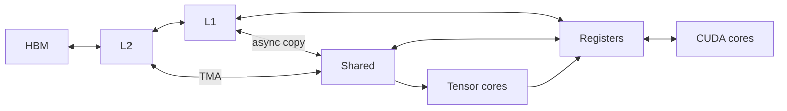

# H100 resource graph v2

`src/kernel_mcts/resource_graph.py` builds a compact graph for one non-MIG H100
SXM worker with compute capability 9.0. The graph is diagnostic evidence. It is
not used by MCTS selection, node validity, reward, or budget accounting.



The graph also records the SM count and a coupled L1/shared-memory pool. Edges
represent useful data paths, not a cycle-accurate physical network. Hopper's
TMA path between global and shared memory and configurable L1/shared carveout
are described in the [Hopper Tuning Guide](https://docs.nvidia.com/cuda/hopper-tuning-guide/index.html).

## Evidence and uncertainty

Each numeric value carries a unit, basis, and source. The worker manifest's
`total_memory_bytes` and `sm_count`, when present, take precedence over nominal
product values. The current H100 trace observed 85,520,809,984 memory bytes but
did not report SM count, so the graph uses NVIDIA's nominal 132 SMs for SXM.
NVIDIA publishes a 50 MB L2, 128 FP32 CUDA cores and four Tensor Cores per SM
for the SXM product; the [Hopper architecture description](https://developer.nvidia.com/blog/nvidia-hopper-architecture-in-depth/)
is the source of those nominal values.

The [Hopper Tuning Guide](https://docs.nvidia.com/cuda/hopper-tuning-guide/index.html)
specifies 64K 32-bit registers per SM, a configurable shared-memory maximum of
228 KiB per SM, and a 256 KiB combined L1/shared pool. The graph records the
shared-memory maximum and the combined constraint separately; it does not add
the two maxima. The L1 capacity is unknown until its carveout is observed.

Version 2 also records architectural maxima: 255 registers per thread, 65,536
registers per block, 1,024 threads per block, 2,048 resident threads and 32
resident blocks per SM, and 227 KiB shared memory per block. These are sourced
from the [Hopper Tuning Guide](https://docs.nvidia.com/cuda/hopper-tuning-guide/index.html)
and [CUDA compute-capability table](https://docs.nvidia.com/cuda/cuda-programming-guide/05-appendices/compute-capabilities.html).
The per-block shared-memory maximum may require an explicit opt-in at launch.

The HBM-to-L2 link carries NVIDIA's published 3.35 TB/s H100 SXM memory peak
from the [H100 product specifications](https://www.nvidia.com/en-us/data-center/h100/).
This is an advertised peak, not a measured sustainable bandwidth. Every link
has explicit `sustainable_bandwidth` and `latency` fields with null values and
`uncalibrated` basis. Other peak link rates are also unknown. No guessed
latencies or bandwidths enter the graph.

## Profile overlay and storage

NCU percentages are mapped to HBM, L2, L1, SM, and tensor-compute nodes while
retaining their exact metric names and percent units. They are not converted to
absolute bytes/s or used to fill link latencies. The existing profile remains
the raw measurement record. For the BF16 GEMM root in
`compiler-context-h100-v2.sqlite`, the mapped HBM and L2 throughput metrics
are 1.40% and 11.36% of NCU's sustained-peak references, respectively.

SQLite stores one graph per H100 run in `hardware_resource_graphs` and one
profile overlay per profiled node in `hardware_resource_observations`. Older
traces are refreshed to graph v2 when opened by `SQLiteTraceStore` (SQLite
schema 12). The local validation trace has eight graph nodes, nine links, and
one root profile overlay. Other GPU models, PCIe H100, multi-GPU runs, and
manifests with a nonempty MIG configuration do not get this SXM graph.

The trace browser's **GPU resources** panel draws this graph when a run is
loaded. Select a kernel to compare its `ptxas` register/shared-memory report and
recorded block size with the architectural maxima. Register use per block is a
lower bound because register allocation granularity is not modeled. If dynamic
shared memory is missing, the static amount is also only a lower bound. A
within-limit assessment does not prove launch feasibility, and the display does
not affect MCTS decisions. NCU percentages appear when the selected kernel has
a profile. Select a resource or path to inspect its evidence. For example:

```bash
.venv/bin/python -m kernel_mcts.trace_browser --trace-dir .
```

The browser reads SQLite files without modifying them. For an older H100 trace
that has a manifest but lacks a v2 graph, it derives the v2 view and any NCU
overlay in memory. A run without a supported H100 SXM 80 GB manifest displays
an unavailable message instead of an inferred graph.

Next calibration work should measure absolute DRAM bytes and elapsed time on
the same worker, then benchmark specific links to estimate sustainable
bandwidth and latency ranges. New estimates should retain workload, toolchain,
and measurement provenance. The dataflow overlay can use the graph now for
memory placement and capacity hypotheses, while leaving unmeasured link costs
unknown.
